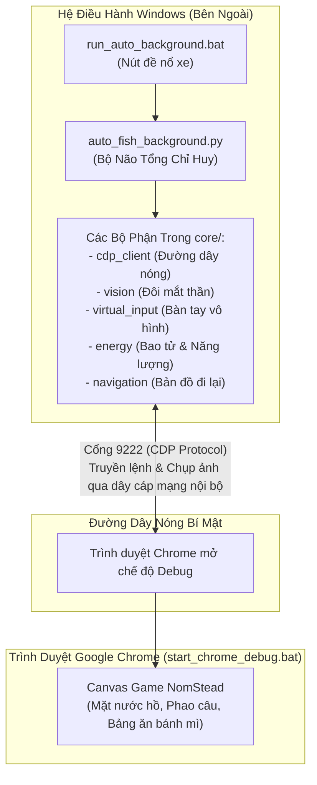
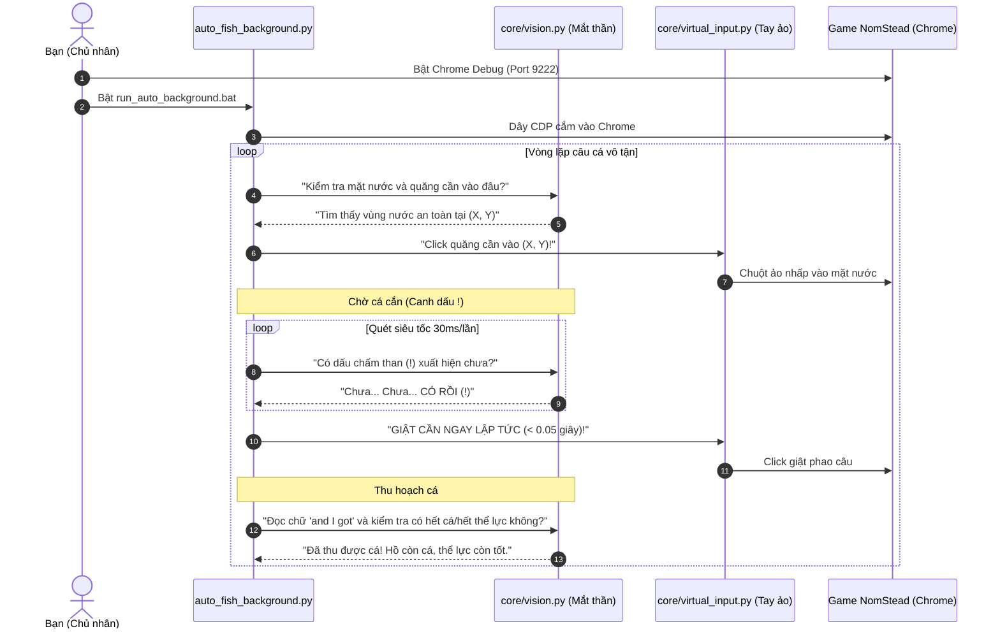

# 📘 SỔ TAY HIỂU DỰ ÁN AUTO CÂU CÁ NOMSTEAD
> **Dành riêng cho bạn** — Người mới bắt đầu từ con số 0 với lập trình.  
> Cuốn sổ tay này là bản đồ gối đầu giường, giúp bạn hiểu rõ từng viên gạch, từng dòng điện chạy ngầm trong con bot của mình.

---

## 🗺️ 1. BỨC TRANH TOÀN CẢNH (KIẾN TRÚC HỆ THỐNG)

Con bot của bạn hoạt động giống như một **"Người tí hon vô hình ngồi điều khiển Chrome từ xa"**:



### Ẩn dụ đời thường:
1. **Google Chrome (start_chrome_debug.bat):** Là một ngôi nhà kính đang mở sẵn một **"cửa hậu đặc biệt" (Cổng 9222)**.
2. **Python Code (auto_fish_background.py):** Là **người thợ bên ngoài** cầm một ống nghe điện thoại cắm thẳng vào cửa hậu đó.
3. **Mỗi khi câu cá:** Người thợ hỏi *"Trong nhà kính đang có hình ảnh gì?"* -> Cửa hậu gửi ảnh ra -> Người thợ tính toán -> Người thợ bấm nút gửi lệnh ngầm *"Hãy bấm vào tọa độ (X, Y) giúp tôi"* -> Trình duyệt tự nhấp chuột bên trong mà không hề chạm vào con chuột thật của máy tính!

---

## 📂 2. CẤU TRÚC THƯ MỤC VÀ VAI TRÒ TỪNG FILE

```text
autocauca/
│
├── 🚀 run_auto_background.bat      # File kích hoạt chạy bot ngầm bằng 1 cú đúp chuột
├── 🌐 start_chrome_debug.bat       # File khởi động Chrome có mở "cổng hậu 9222"
├── 🧠 auto_fish_background.py      # Bộ não trung tâm: kịch bản điều phối toàn bộ quy trình
│
├── ⚙️ config/
│   └── settings.py                # Bảng công tắc / Bảng thông số: chỉnh thời gian, phím tắt, độ nhạy
│
├── 🧩 core/                        # Các cơ quan nội tạng của con bot:
│   ├── cdp_client.py              # Dây cáp kết nối Python với Chrome (CDP)
│   ├── virtual_input.py           # Bàn tay vô hình: click, di chuột lượn sóng Bezier không cướp chuột
│   ├── vision.py                  # Đôi mắt thần: OpenCV tìm hồ, RapidOCR đọc chữ số
│   ├── navigation.py              # Đôi chân: mở Codex, lướt tìm tên hồ từ 1 đến 40, dịch chuyển tức thời
│   ├── energy.py                  # Chiếc dạ dày: kiểm tra thể lực, tự ăn bánh mì khi mệt
│   ├── watchdog.py                # Vệ sĩ giám sát: gỡ kẹt, đóng bảng quảng cáo lạ, tải lại game nếu lỗi
│   ├── scheduler.py               # Đồng hồ sinh học: nghỉ giải lao ngắn (micro-break), chờ reset server
│   └── logger.py                  # Miệng thông báo: in màu sắc đẹp mắt ra màn hình đen console
│
└── 🖼️ assets/templates/             # Bộ album ảnh mẫu:
    ├── cham_than.png              # Ảnh mẫu dấu chấm than (!) khi cá cắn câu
    ├── ho_nuoc.png                # Ảnh mẫu nhận diện mặt nước
    ├── btn_codex.png              # Ảnh mẫu nút mở sổ tay Codex
    ├── tab_bookmarks.png          # Ảnh mẫu thẻ đánh dấu địa điểm
    ├── banh_mi.png                # Ảnh mẫu ổ bánh mì
    └── ...
```

---

## 🛠️ 3. BẢNG GIẢI MÃ CÁC "VŨ KHÍ BÍ MẬT" (THƯ VIỆN & CÔNG NGHỆ)

| Tên Vũ Khí | Tên Gọi Đời Thường | Công Việc Thực Tế Trong Code | Nếu Thiếu Nó Thì Sao? |
| :--- | :--- | :--- | :--- |
| **Python** | **Người Nhạc Trưởng** | Đọc các file chữ `.py` và biến nó thành các chỉ thị hành động cho máy tính. | Không có gì để chạy. |
| **Playwright & CDP** | **Đường Dây Nóng Vô Hình** | Cắm vào cổng 9222 của Chrome, điều khiển mọi cử động của trang web từ bên ngoài mà người dùng không thấy chuột bị cướp. | Bot không thể "chui" vào trong Chrome được. |
| **OpenCV (`cv2`)** | **Kính Hiển Vi Xử Lý Ảnh** | Quét từng điểm ảnh màu xanh ngọc của hồ nước, làm mòn mép bờ (Erosion) để phao câu luôn rơi chính giữa hồ, so khớp ảnh mẫu `cham_than.png`. | Bot sẽ bị "mù", không biết hồ ở đâu, không biết khi nào có dấu `!`. |
| **NumPy** | **Thước Kẻ Lập Phương Siêu Tốc** | Biến bức ảnh hàng triệu điểm ảnh thành một bảng số ma trận khổng lồ để tính toán cực nhanh trong vài phần nghìn giây. | OpenCV không thể xử lý nổi ảnh ở tốc độ cao, bot sẽ giật cá trễ. |
| **RapidOCR (ONNX)** | **Cặp Kính Đọc Chữ AI** | Nhìn vào bức ảnh và đọc ra chữ thật: đọc xem đang ở "Hồ 15" hay "Hồ 30", đọc số thể lực còn bao nhiêu, đọc chữ "and I got...". | Bot không biết mình đang đứng ở hồ số mấy để lướt danh sách. |
| **Đường Cong Bezier** | **Khớp Cổ Tay Con Người** | Làm cho đường di chuyển của chuột có độ cong mềm mại, rung lắc tự nhiên như tay người thật, tránh bị game nghi ngờ là bot. | Chuột giật thẳng tắp như máy móc (dễ bị phát hiện gian lận). |

---

## 🔄 4. CHU KỲ CÂU 1 CON CÁ (VÒNG ĐỜI KỲ DIỆU)



---

## 💡 5. NGUYÊN TẮC VÀNG ĐỂ TỰ TIN LÀM CHỦ DỰ ÁN
1. **Không sợ hỏng:** Mọi file code đều là văn bản. Bạn luôn có thể Ctrl+Z hoặc copy bản dự phòng.
2. **File `settings.py` là người bạn thân:** 90% những thứ bạn muốn tinh chỉnh (chỉnh thời gian nhanh chậm, bật tắt tính năng, đổi phím tắt) đều nằm tập trung ở file này mà không cần động vào cấu trúc thuật toán phức tạp.
3. **Mỗi file một nhiệm vụ:** Khi có lỗi về mắt nhìn -> kiểm tra `vision.py`. Lỗi về chuột bấm -> kiểm tra `virtual_input.py`. Lỗi về đi lại -> kiểm tra `navigation.py`.

---
*Tài liệu này được biên soạn bởi người thầy AI tận tâm — Hãy mở lại xem bất cứ khi nào bạn thấy bỡ ngỡ!*

