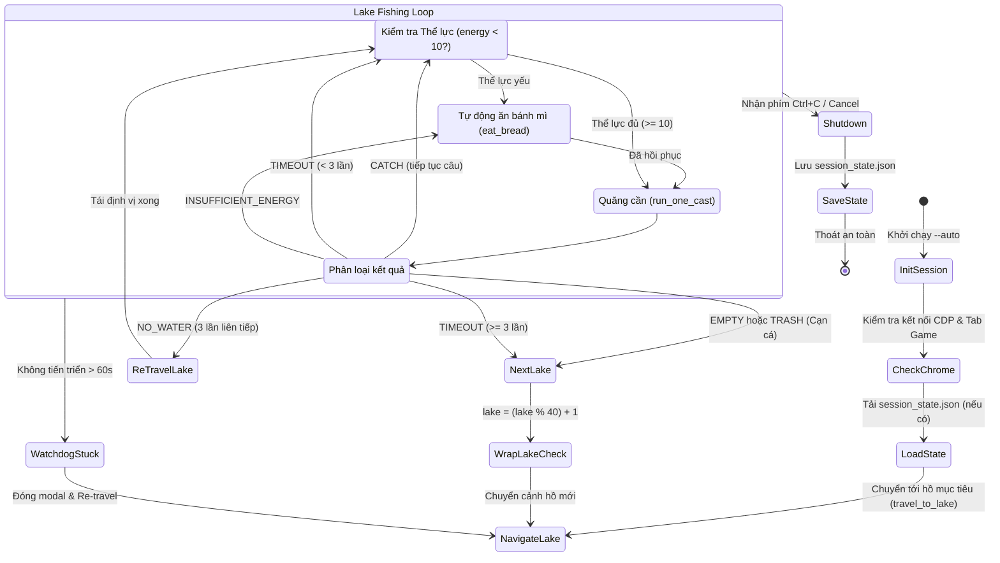

# Task 5.2 Brief — Infinite Autonomous Fishing Loop (`--auto`), Watchdog, and Launch Script (`run_auto.bat`)

**Ngày ban hành:** 17/11/2026 (Asia/Saigon)  
**Phạm vi:** Hoàn thiện bước cuối cùng của Milestone 3 — Đưa công cụ Auto Fishing NomStead vào trạng thái hoạt động tự động bất tận (`--auto`), quản lý trọn vẹn chu trình 40 hồ, tự động hồi phục thể lực, cơ chế Watchdog chống kẹt, lưu trữ trạng thái phiên làm việc (`session_state.json`), và kịch bản khởi chạy tiện lợi (`run_auto.bat`).  
**Tiền đề:** Task 5.1 (Bread Recovery & Lake Navigation Primitives) đã được Sub-agent 3 (Tester) chính thức nghiệm thu 100% PASS (150/150 tests Python pass, `bread.rgb` 4,257 bytes khớp SHA-256).

---

## 1. Mục tiêu Kỹ thuật Toàn diện

1. **Vòng lặp Treo Game Bất Tận (`run_auto_session`):**
   - Triển khai trong `rust/hybrid/bridge.py`:
     ```python
     async def run_auto_session(
         tab: Tab,
         config: Optional[AutoSessionConfig] = None,
         use_worker: bool = True,
     ) -> SessionState:
     ```
   - Quản lý trạng thái phiên làm việc (`SessionState`) với khả năng lưu và tải từ tệp JSON (`session_state.json`).
   - Tự động luân chuyển mượt mà qua toàn bộ 40 hồ câu:
     + Khi hồ cạn cá (`EMPTY`) hoặc câu trúng rác (`TRASH`): Tự động chuyển sang hồ tiếp theo `(current_lake % max_lakes) + 1`.
     + Khi hoàn thành hồ 40: Tự động tua vòng (wrap-around) về hồ 1.
   - Tự động duy trì thể lực (Energy Recovery):
     + Kiểm tra trước mỗi lần quăng cần: nếu thể lực `< 10` (hoặc gặp `INSUFFICIENT_ENERGY`) $\Rightarrow$ tự động gọi `eat_bread(tab)`.
   - Xử lý các tình huống bất thường tại hồ:
     + Gặp `NO_WATER`: thử lại tối đa 3 lần; nếu vẫn không thấy nước $\Rightarrow$ tự động `travel_to_lake` lại chính hồ hiện tại để điều chỉnh lại góc đứng/camera của nhân vật.
     + Gặp `TIMEOUT` liên tiếp 3 lần: cá không cắn $\Rightarrow$ coi như cạn cá, chuyển sang hồ kế tiếp.
   - Cơ chế Giám sát Chống kẹt (Watchdog Timer):
     + Đo thời gian không có hoạt động tiến triển (`idle_timeout = 60.0s`).
     + Nếu bị kẹt quá 60s mà không có tương tác thành công $\Rightarrow$ tự động gửi phím Escape làm sạch UI modal và kích hoạt điều hướng lại hồ hiện tại.
   - Dừng phiên an toàn (Graceful Shutdown):
     + Bắt tín hiệu ngắt `asyncio.CancelledError`, `KeyboardInterrupt`, hoặc cờ dừng `stop_requested`.
     + Đảm bảo giải phóng chuột (`mouseReleased`), lưu trạng thái phiên vào đĩa và đóng kết nối sạch sẽ.

2. **Giao diện Dòng Lệnh CLI (`--auto`):**
   - Hỗ trợ các cờ dòng lệnh mới trong `bridge.py`:
     + `--auto`: kích hoạt chế độ treo game tự động.
     + `--lake <N>`: số hồ bắt đầu (nguyên từ 1 đến 40, mặc định: 1).
     + `--state-file <PATH>`: đường dẫn tệp trạng thái (mặc định: `session_state.json`).
     + `--max-catches <N>`: giới hạn số cá bắt tối đa (phục vụ test hoặc cắm máy theo chỉ tiêu).
     + `--max-lakes <N>`: tổng số hồ hỗ trợ (mặc định: 40).
   - In bảng báo cáo trực quan (Dashboard) cập nhật thời gian thực trên console:
     ```text
     ==============================================================
     NOMSTEAD AUTONOMOUS FISHING SESSION
     ==============================================================
     Current Lake   : Lake 12 / 40
     Session Time   : 01h 24m 15s
     Total Catches  : 48 fish
     Total Casts    : 62 casts (Success rate: 77.4%)
     Current Energy : 58 / 80
     Last Outcome   : CATCH (reaction: 245 ms)
     Watchdog State : OK (last active: 2.1s ago)
     ==============================================================
     ```

3. **Kịch bản Khởi chạy Tiện lợi (`rust/hybrid/run_auto.bat`):**
   - Kiểm tra cổng debug 9222:
     + Nếu chưa phát hiện Chrome debug $\Rightarrow$ tự động gọi `start_chrome_debug.bat` hoặc hướng dẫn người dùng khởi động Chrome debug.
   - Nhập tham số thân thiện:
     + Cho phép bấm Enter để dùng mặc định (Hồ 1) hoặc nhập số hồ mong muốn từ 1 đến 40.
   - Thực thi `python bridge.py --auto --lake %LAKE%`.
   - Màu sắc bảng điều khiển chuyên nghiệp, hướng dẫn rõ ràng phím tắt dừng `Ctrl+C`.

4. **Bộ Kiểm thử Nghiệm thu Độc lập (`tests/test_auto_session.py`):**
   - Xây dựng tối thiểu 9 test cases bao phủ toàn bộ luồng tự động.
   - Nâng tổng số test Python từ 150 lên tối thiểu **159/159 tests PASS 100%**, exit code 0, 0 skips.

---

## 2. Kiến trúc & Sơ đồ Luồng Trạng thái (State Diagram)



---

## 3. Đặc tả Cấu trúc Dữ liệu & Giao diện Code

### 3.1. Dataclasses trong `rust/hybrid/bridge.py`

```python
@dataclass
class AutoSessionConfig:
    start_lake: int = 1                         # Hồ bắt đầu (1..40)
    max_lakes: int = 40                         # Tổng số hồ (40)
    energy_low_threshold: int = 10              # Ngưỡng thể lực cần ăn bánh mì
    max_no_water_retries: int = 3               # Số lần NO_WATER tối đa trước khi re-travel
    max_timeout_retries: int = 3                # Số lần TIMEOUT tối đa trước khi đổi hồ
    idle_timeout_seconds: float = 60.0          # Thời gian watchdog phát hiện kẹt
    max_catches: Optional[int] = None           # Dừng khi đạt số cá này (None = vô tận)
    state_file: str = "session_state.json"      # Đường dẫn file lưu trạng thái

@dataclass
class SessionState:
    current_lake: int = 1                       # Hồ hiện tại
    total_catches: int = 0                      # Tổng số cá đã câu thành công
    total_casts: int = 0                        # Tổng số lần quăng cần
    consecutive_no_water: int = 0               # Biến đếm lỗi no water liên tiếp
    consecutive_timeout: int = 0                # Biến đếm timeout liên tiếp
    start_time: float = field(default_factory=time.time)
    last_activity_time: float = field(default_factory=time.time)
    lake_catches: Dict[int, int] = field(default_factory=dict)

    def to_dict(self) -> Dict[str, Any]:
        return {
            "current_lake": self.current_lake,
            "total_catches": self.total_catches,
            "total_casts": self.total_casts,
            "start_time": self.start_time,
            "last_activity_time": self.last_activity_time,
            "lake_catches": {str(k): v for k, v in self.lake_catches.items()},
        }

    @classmethod
    def from_dict(cls, data: Dict[str, Any]) -> "SessionState":
        state = cls(
            current_lake=int(data.get("current_lake", 1)),
            total_catches=int(data.get("total_catches", 0)),
            total_casts=int(data.get("total_casts", 0)),
            start_time=float(data.get("start_time", time.time())),
            last_activity_time=float(data.get("last_activity_time", time.time())),
        )
        if "lake_catches" in data and isinstance(data["lake_catches"], dict):
            state.lake_catches = {int(k): int(v) for k, v in data["lake_catches"].items()}
        return state

    def save(self, filepath: str) -> None:
        """Ghi an toàn ra file tạm rồi atomic rename."""
        tmp_file = f"{filepath}.tmp"
        with open(tmp_file, "w", encoding="utf-8") as f:
            json.dump(self.to_dict(), f, indent=2, ensure_ascii=False)
        os.replace(tmp_file, filepath)

    @classmethod
    def load(cls, filepath: str) -> Optional["SessionState"]:
        if not os.path.exists(filepath):
            return None
        try:
            with open(filepath, "r", encoding="utf-8") as f:
                return cls.from_dict(json.load(f))
        except Exception:
            return None
```

### 3.2. Logic Vòng lặp Chính (`run_auto_session`)

1. **Khởi tạo & Khôi phục Phiên:**
   - Đọc cấu hình từ `AutoSessionConfig`.
   - Nếu tồn tại file trạng thái `config.state_file` $\Rightarrow$ tải lại `SessionState`. Nếu có `--lake` được chỉ định từ CLI $\Rightarrow$ ưu tiên ghi đè `current_lake = args.lake`.
   - Khởi tạo kết nối CDP an toàn với tab game.
2. **Vòng lặp Duyệt Hồ (Outer Lake Loop):**
   - Di chuyển tới hồ hiện tại: `await travel_to_lake(tab, state.current_lake)`.
   - Nếu điều hướng thất bại: tăng hồ lên `(state.current_lake % max_lakes) + 1` và thử tiếp.
3. **Vòng lặp Câu tại Hồ (Inner Fishing Loop):**
   - **Kiểm tra thể lực:**
     + Đọc `status = await read_status(tab)`.
     + Nếu `status.energy is not None and status.energy < config.energy_low_threshold`:
       * Gọi `await eat_bread(tab)`.
   - **Thực hiện một lượt câu:**
     + Gọi `outcome = await run_one_cast(tab, use_worker=use_worker)`.
     + Cập nhật `state.total_casts += 1`, `state.last_activity_time = time.time()`.
   - **Phân nhánh xử lý kết quả (`outcome.kind`):**
     + `CATCH`:
       * `state.total_catches += 1`
       * `state.lake_catches[state.current_lake] = state.lake_catches.get(state.current_lake, 0) + 1`
       * `state.consecutive_no_water = 0`
       * `state.consecutive_timeout = 0`
       * `state.save(config.state_file)`
       * Kiểm tra nếu đạt `config.max_catches` $\Rightarrow$ hoàn thành và thoát vòng lặp.
     + `INSUFFICIENT_ENERGY`:
       * Gọi `await eat_bread(tab)`.
     + `EMPTY` hoặc `TRASH`:
       * Hồ đã cạn cá!
       * `state.consecutive_no_water = 0`
       * `state.consecutive_timeout = 0`
       * Đổi hồ: `state.current_lake = (state.current_lake % config.max_lakes) + 1`
       * `state.save(config.state_file)`
       * Thoát vòng lặp câu của hồ hiện tại $\Rightarrow$ chuyển cảnh hồ mới.
     + `NO_WATER`:
       * `state.consecutive_no_water += 1`
       * Nếu `state.consecutive_no_water >= config.max_no_water_retries` (3):
         - `state.consecutive_no_water = 0`
         - Thoát vòng lặp hiện tại để kích hoạt `travel_to_lake` lại chính hồ này (re-position nhân vật).
     + `TIMEOUT`:
       * `state.consecutive_timeout += 1`
       * Nếu `state.consecutive_timeout >= config.max_timeout_retries` (3):
         - Cá không cắn sau 3 lần timeout!
         - `state.consecutive_timeout = 0`
         - Đổi hồ: `state.current_lake = (state.current_lake % config.max_lakes) + 1`
         - `state.save(config.state_file)`
         - Thoát vòng lặp hiện tại để chuyển hồ mới.
     + `MODAL_ACTIVE`:
       * Gửi phím Escape để đóng modal làm sạch UI.
   - **Giám sát Watchdog:**
     + Nếu `time.time() - state.last_activity_time > config.idle_timeout_seconds`:
       * Phát hiện kẹt quá 60s không tiến triển $\Rightarrow$ gửi Escape và điều hướng lại `state.current_lake`.
       * Reset `state.last_activity_time = time.time()`.
4. **Xử lý Ngắt & Thoát An toàn (Graceful Shutdown):**
   - Khối `try...finally` đảm bảo:
     + Lưu trạng thái cuối cùng vào `config.state_file`.
     + In tóm tắt phiên làm việc (Session Summary).

---

## 4. Kịch bản Khởi chạy (`rust/hybrid/run_auto.bat`)

Tạo file `rust/hybrid/run_auto.bat` với nội dung hoàn chỉnh:

```bat
@echo off
setlocal enabledelayedexpansion
title NomStead Auto Fishing - Infinite Loop Mode
color 0B

echo ================================================================
echo       NOMSTEAD HYBRID RUST/PYTHON AUTONOMOUS FISHING TOOL
echo ================================================================
echo.

cd /d "%~dp0"

:: 1. Kiem tra cong Chrome Debug 9222
echo [1/3] Kiem tra ket noi Chrome Remote Debugging (port 9222)...
netstat -ano | findstr :9222 >nul
if %errorlevel% neq 0 (
    echo [CANH BAO] Khong tim thay Chrome dang chay tren cong 9222!
    if exist "..\..\python\start_chrome_debug.bat" (
        echo Dang khoi dong Chrome Debug tu dong...
        start "" "..\..\python\start_chrome_debug.bat"
        timeout /t 3 /nobreak >nul
    ) else (
        echo Vui long chay start_chrome_debug.bat truoc de mo game tren Chrome Debug!
        pause
        exit /b 1
    )
) else (
    echo [OK] Chrome Debug port 9222 da san sang.
)

:: 2. Nhap so ho bat dau
echo.
echo [2/3] Cau hinh phien cau ca:
set /p START_LAKE="Nhap so ho bat dau [1-40] (Nhan Enter de dung mac dinh ho 1): "
if "%START_LAKE%"=="" set START_LAKE=1

:: Kiem tra hop le ho
if %START_LAKE% lss 1 (
    set START_LAKE=1
)
if %START_LAKE% gtr 40 (
    set START_LAKE=40
)

:: 3. Chay Auto Loop
echo.
echo [3/3] Dang khoi dong Vong lap Treo Game Bat tan...
echo ----------------------------------------------------------------
echo Ho bat dau : Ho %START_LAKE%
echo Che do     : Auto Loop 40 Ho (Co che hoi phuc Banh mi + Watchdog)
echo Huong dan  : Nhan Ctrl+C de DUNG TOOL AN TOAN bat cu luc nao.
echo ----------------------------------------------------------------
echo.

python bridge.py --auto --lake %START_LAKE%

echo.
echo ================================================================
echo Phien cau ca da ket thuc an toan.
echo ================================================================
pause
```

---

## 5. Danh mục Kiểm thử Chi tiết (`rust/hybrid/tests/test_auto_session.py`)

Xây dựng bộ kiểm thử giả lập (mocked) 100% offline, không phụ thuộc trình duyệt sống:

1. `test_01_advance_lake_on_empty_or_trash_outcome`:
   - Giả lập `run_one_cast` trả về `Outcome(kind="EMPTY")` tại Hồ 5.
   - Khẳng định: vòng lặp đổi sang Hồ 6 và gọi `travel_to_lake(tab, 6)`.
   - Giả lập tiếp `Outcome(kind="TRASH")` tại Hồ 6 $\Rightarrow$ đổi tiếp sang Hồ 7.
2. `test_02_eat_bread_when_energy_below_threshold`:
   - Giả lập `status.energy = 8` (< 10).
   - Khẳng định: `eat_bread` được gọi tự động trước khi quăng cần.
   - Thử nghiệm tiếp khi `outcome.kind == "INSUFFICIENT_ENERGY"` $\Rightarrow$ `eat_bread` được gọi ngay lập tức.
3. `test_03_wrap_around_from_lake_40_to_lake_1`:
   - Giả lập phiên đang ở Hồ 40 và nhận kết quả `EMPTY`.
   - Khẳng định: `state.current_lake` tua vòng về Hồ 1 (`current_lake == 1`) và gọi `travel_to_lake(tab, 1)`.
4. `test_04_consecutive_no_water_triggers_retravel`:
   - Giả lập `run_one_cast` trả về `NO_WATER` 3 lần liên tiếp tại Hồ 8.
   - Khẳng định: hệ thống kích hoạt `travel_to_lake(tab, 8)` để re-position lại vị trí đứng của nhân vật.
5. `test_05_consecutive_timeouts_advances_to_next_lake`:
   - Giả lập `run_one_cast` trả về `TIMEOUT` 3 lần liên tiếp tại Hồ 15.
   - Khẳng định: hệ thống kết luận cá không cắn và tự động đổi sang Hồ 16 (`travel_to_lake(tab, 16)`).
6. `test_06_session_state_persistence_and_resume`:
   - Khởi tạo `SessionState` với 10 cá bắt được tại Hồ 4.
   - Lưu ra tệp tạm `test_session_state.json`.
   - Tải lại và xác nhận: `current_lake == 4`, `total_catches == 10`, `lake_catches[4] == 10`.
7. `test_07_graceful_shutdown_on_cancellation_saves_state`:
   - Giả lập ném ngoại lệ `asyncio.CancelledError` giữa phiên.
   - Khẳng định: tệp `session_state.json` vẫn được ghi đầy đủ và toàn vẹn, không bị hỏng hóc hoặc mất dữ liệu.
8. `test_08_watchdog_detects_stuck_and_recovers`:
   - Giả lập `last_activity_time` cách hiện tại 65.0s (> 60.0s).
   - Khẳng định: Watchdog phát hiện kẹt, kích hoạt gửi phím Escape và re-travel lại hồ hiện tại.
9. `test_09_cli_auto_flags_parsing`:
   - Kiểm tra parser dòng lệnh với `--auto`, `--lake 25`, `--state-file custom.json`, `--max-catches 50`.
   - Khẳng định các giá trị được gán chính xác vào cấu hình `AutoSessionConfig`.
   - Kiểm tra từ chối hoặc chuẩn hóa hồ ngoài dải $1 \dots 40$.

---

## 6. Lệnh Kiểm tra Nghiệm thu

Từ thư mục gốc workspace `e:\tool\banhoanhaotrutocdo\autocauca`:

```powershell
# 1. Chạy riêng bộ test auto session mới
python -m unittest discover -s rust/hybrid/tests -p "test_auto_session.py" -v

# 2. Chạy toàn bộ test suite Python hồi quy (Yêu cầu >= 159/159 PASS, 0 skips, 0 errors)
python -m unittest discover -s rust/hybrid/tests -p "test_*.py" -v

# 3. Kiểm tra cú pháp và sự tồn tại của file launch script run_auto.bat
Test-Path rust/hybrid/run_auto.bat
```

---

## 7. Phân công Thực hiện cho Sub-agent 2 (Coder)

1. **Cập nhật `rust/hybrid/bridge.py`:**
   - Thêm `AutoSessionConfig` và `SessionState` (hỗ trợ lưu/tải JSON).
   - Triển khai hàm `run_auto_session(tab, config, use_worker)`.
   - Bổ sung các cờ CLI `--auto`, `--lake`, `--state-file`, `--max-catches`, `--max-lakes` trong hàm `main()`.
   - Cập nhật hàm `_main_async()` để điều hướng chạy `run_auto_session`.
2. **Tạo kịch bản khởi chạy `rust/hybrid/run_auto.bat`:**
   - Đảm bảo đầy đủ logic kiểm tra port 9222, nhập hồ bắt đầu, tiêu đề đẹp mắt và hướng dẫn thoát an toàn.
3. **Tạo file test `rust/hybrid/tests/test_auto_session.py`:**
   - Viết 9 test cases độc lập theo đúng danh mục mục 5.
4. **Kiểm thử nghiệm thu:**
   - Chạy toàn bộ test suite: xác nhận **$\ge 159/159$ tests PASS 100%**, exit code 0.
   - Lập báo cáo `TASK5_2_CODER_REPORT.md` và bàn giao sang Sub-agent 3 (Tester).
