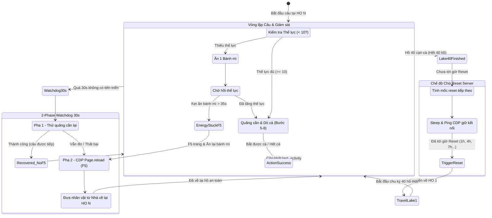

# Task 6.3 Brief — Energy Stuck Reload, 2-Phase 30s Watchdog & Server Reset Waiting Mode (Bước 9 & Bước 10)

**Ngày ban hành:** 17/11/2026 (Asia/Saigon)  
**Phạm vi:** Hoàn thiện và chuẩn hóa 100% hai bước nghiệp vụ bảo vệ tự động tối hậu (Bước 9 & Bước 10) của công cụ Auto Fishing NomStead: Tự động ăn bánh mì hồi thể lực với cơ chế F5 Reload khi kẹt 30–40s (Bước 9); Cơ chế Watchdog 30s hai pha (Pha 1: Quăng cần thử lại $\to$ Pha 2: F5 Reload & Tái điều hướng từ Nhà về hồ) và Cơ chế canh giờ Reset Server kèm chế độ chờ thông minh sau 40 hồ (Bước 10).  
**Tiền đề:** Task 6.2 đã được Tester nghiệm thu chính thức 100% PASS (193/193 tests Python pass). Các bước từ Bước 1 đến Bước 8 đã hoàn thành trọn vẹn.

---

## 1. Phân tích Chi tiết Nghiệp vụ & Kỹ thuật

### 1.1. Bước 9: Tự động Ăn Bánh mì Hồi Thể lực & Cơ chế F5 Khi Kẹt 30–40s
- **Nghiệp vụ cơ bản:**
  + Khi hết thể lực (thông báo `"Your energy level is insufficient."` hoặc chỉ số thể lực $< 10$): Hệ thống tự động kích hoạt `eat_bread(tab)`.
  + `eat_bread` nhận diện bánh mì trên thanh Quick-slot hoặc ROI đáy màn hình và bấm ăn đúng 1 cái bánh mì.
- **Hiện tượng kẹt giao diện & Giải pháp F5:**
  + Trong môi trường thực tế, giao diện game NomStead có thể bị lag, kẹt tooltip, hoặc mất focus khiến click bánh mì không có tác dụng (`consumed == False`).
  + Nếu tình trạng thiếu thể lực kéo dài quá **$30 \dots 40$ giây** mà vẫn không tăng được thể lực:
    $\Rightarrow$ Kích hoạt cơ chế tự phục hồi tối hậu: **F5 (Reload) lại trang web qua CDP `Page.reload`**.
  + Sau khi reload: Đợi canvas tải lại $\to$ gọi `eat_bread(tab, force=True)` $\to$ đưa nhân vật từ Nhà về lại hồ đang câu qua `travel_to_lake(tab, state.current_lake)`.

### 1.2. Bước 10: Cơ chế Watchdog 30s Hai Pha (2-Phase Watchdog)
- **Vấn đề thực tế:**
  + Khi treo máy dài hạn, nhân vật có thể bị đơ tư thế quăng cần, mất kết nối websocket tạm thời, hoặc hồ nước bị lỗi hiển thị.
  + Nếu đặt ngưỡng phát hiện kẹt là 60s thì quá dài (lãng phí thời gian); nếu F5 ngay lập tức khi vừa chạm 30s thì lại quá vội vàng (có thể chỉ do cá cắn muộn).
- **Giải pháp 2 Pha (2-Phase Watchdog 30s):**
  + **Pha 1 (Thử quăng lại — Recast):**  
    Khi hệ thống không có hoạt động tiến triển quá **30 giây**:  
    Thay vì F5 ngay lập tức, bot chủ động thực hiện thêm 1 cú quăng cần thử lại (`recast`): `await run_one_cast(tab)`.  
    *Nếu cú quăng lại này câu tiếp được bình thường (có cá cắn hoặc hoàn thành chu kỳ)*:  
    $\Rightarrow$ Phục hồi thành công! Cập nhật lại mốc thời gian hoạt động, tiếp tục câu, **KHÔNG CẦN F5**!
  + **Pha 2 (F5 Reload & Anti-Home Recovery):**  
    *Nếu cú quăng lại ở Pha 1 vẫn thất bại* (vẫn báo `NO_WATER`, `TIMEOUT`, hoặc lỗi đơ):  
    $\Rightarrow$ Xác nhận nhân vật bị kẹt cứng toàn diện. Kích hoạt **F5 (Page.reload)**!

### 1.3. Lưu ý SỐNG CÒN sau khi F5: Bẫy Nhà (Anti-Home Trap)
- **Đặc thù Game NomStead:**
  + Mỗi khi F5 lại trang web, game NomStead **luôn đưa nhân vật hồi sinh về Nhà (Home)**.
  + Tại Nhà, hoàn toàn **KHÔNG CÓ MẶT NƯỚC** để câu cá! Nếu quăng cần ngay sau khi F5, bot sẽ báo `NO_WATER` liên tục.
- **Quy trình Phục hồi Bắt buộc sau F5 (`recover_from_reload`):**
  1. Gửi lệnh CDP `Page.reload` với `ignoreCache=True`.
  2. Chờ game tải lại canvas và DOM ổn định ($2.0 \dots 2.5$ giây).
  3. Gửi phím `Escape` và click `.close-btn` để dọn dẹp các popup chào mừng/modal.
  4. **BẮT BUỘC:** Gọi ngay `travel_to_lake(tab, state.current_lake)` để mở `Codex -> Bookmarks` đưa nhân vật từ Nhà di chuyển về đúng hồ đang câu!
  5. Chỉ sau khi đã về tới hồ thành công thì mới bắt đầu lại chu kỳ câu.

### 1.4. Canh giờ Reset Server & Chế độ Chờ Reset Sau 40 Hồ
- **Quy luật Server NomStead:**
  + Server reset cá toàn bộ 40 hồ vào các mốc 3 tiếng:  
    `RESET_HOURS = [1, 4, 7, 10, 13, 16, 19, 22]` (01:00, 04:00, 07:00, 10:00, 13:00, 16:00, 19:00, 22:00).
- **Chế độ Chờ Reset Thông Minh sau 40 Hồ (`wait_until_next_reset_hour`):**
  + Khi bot đã câu hết cả 40 hồ (hồ 40 báo `EMPTY` hoặc `TRASH`) mà chưa tới khung giờ reset tiếp theo:
    Thay vì tiếp tục tua lại các hồ cạn cá vô ích, bot tự động kích hoạt **Chế độ Chờ Reset**.
  + Tính mốc reset tiếp theo bằng `get_next_reset_datetime()`.
  + Ghi log rõ ràng: `[RESET SERVER] Đã câu xong 40 hồ! Chuyển sang chế độ nghỉ ngơi chờ Reset tiếp theo lúc {H:M} (còn {X} phút)...`.
  + Trong lúc chờ: Gửi micro keep-alive ping định kỳ (mỗi 15–30s) qua CDP nhẹ (`_cdp_evaluate(tab, "1+1")`) để duy trì websocket, tuyệt đối không tiêu tốn CPU.
  + Khi đồng hồ chạm mốc giờ Reset:  
    Ghi log: `[RESET SERVER] ĐÃ TỚI GIỜ RESET SERVER! Tự động quay về HO 1...`  
    Gọi `travel_to_lake(tab, 1)`, gán `state.current_lake = 1`, và khởi động chu kỳ 40 hồ mới!
- **Kích hoạt Reset Tức Thời:**
  + Tại bất kỳ thời điểm nào trong phiên: nếu phát hiện bước sang mốc giờ reset (`is_reset_window()`) và đang ở hồ $> 1$ $\Rightarrow$ tự động chuyển ngay về `HO 1`.

---

## 2. Kiến trúc & Sơ đồ Luồng Trạng thái (Mermaid State Machine)



---

## 3. Đặc tả Kỹ thuật Chi tiết cho `rust/hybrid/bridge.py`

### 3.1. Hàm Tải Lại Trang Web qua CDP (`reload_page`)

```python
async def reload_page(tab: Tab, ignore_cache: bool = True, wait_loaded_sec: float = 2.5) -> None:
    """Tải lại trang web NomStead qua CDP Page.reload và chờ canvas tải lại ổn định."""
    def _get_id():
        if hasattr(tab, "next_id") and callable(tab.next_id):
            return tab.next_id()
        return 1

    async with _resolve_ws(tab) as ws:
        msg_id = _get_id()
        await ws.send(json.dumps({
            'id': msg_id,
            'method': 'Page.reload',
            'params': {'ignoreCache': ignore_cache}
        }))
        try:
            await _receive_cdp_result(ws, msg_id, _CDP_MAX_BYTES)
        except Exception:
            pass

    if wait_loaded_sec > 0:
        await asyncio.sleep(wait_loaded_sec)

    # Đóng popup / modal chào mừng sau khi F5 nếu có
    try:
        await _cdp_evaluate(
            tab,
            """(() => {
                window.dispatchEvent(new KeyboardEvent('keydown', {key: 'Escape', code: 'Escape', bubbles: true}));
                const closeBtn = document.querySelector('.close-btn, [class*="close-btn"], .modal-close, .modal .close, button.close, [aria-label="Close"]');
                if (closeBtn) closeBtn.click();
            })()"""
        )
    except Exception:
        pass
```

### 3.2. Hàm Phục hồi sau F5 Chống Bẫy Nhà (`recover_from_reload`)

```python
async def recover_from_reload(tab: Tab, target_lake: int) -> bool:
    """
    Phục hồi nhân vật sau khi F5:
    Vì sau F5 game luôn đưa nhân vật về Nhà (Home - không có hồ câu),
    hàm này tự động mở Codex -> Bookmarks để di chuyển nhân vật về đúng target_lake.
    """
    await asyncio.sleep(0.5)
    travel_res = await travel_to_lake(tab, target_lake)
    return travel_res.success
```

### 3.3. Hàm Chờ Reset Server Sau Khi Hoàn Thành 40 Hồ (`wait_until_reset_if_needed`)

```python
async def wait_until_reset_if_needed(
    tab: Tab,
    current_lake: int,
    max_lakes: int = 40,
    stop_event: Optional[asyncio.Event] = None,
    poll_interval: float = 15.0,
) -> bool:
    """
    Khi đã câu hết cả max_lakes (40 hồ), nếu chưa tới khung giờ reset tiếp theo:
    Chuyển sang chế độ chờ thông minh, ping keep-alive định kỳ giữ kết nối CDP.
    Khi chạm mốc giờ reset -> tự động di chuyển về HO 1 và trả về True.
    """
    if current_lake < max_lakes:
        return False

    next_reset = get_next_reset_datetime()
    now = datetime.now()
    remaining_sec = (next_reset - now).total_seconds()

    # Nếu chỉ còn dưới 30s hoặc đã qua giờ reset thì không cần chờ
    if remaining_sec <= 30.0:
        return False

    remaining_minutes = remaining_sec / 60.0
    print(f"[{time.strftime('%H:%M:%S')}] [RESET SERVER] Đã hoàn thành {max_lakes} hồ! Chuyển sang chế độ nghỉ ngơi chờ Reset Server tiếp theo lúc {next_reset.strftime('%H:%M')} (còn {remaining_minutes:.1f} phút)...")

    while datetime.now() < next_reset:
        if stop_event is not None and stop_event.is_set():
            return False

        # Sleep nhỏ kèm micro keep-alive ping giữ kết nối CDP
        sleep_chunk = min(poll_interval, max(1.0, (next_reset - datetime.now()).total_seconds()))
        await asyncio.sleep(sleep_chunk)

        try:
            # Micro keep-alive ping (<0.1ms, CPU 0%)
            await _cdp_evaluate(tab, "1+1")
        except Exception:
            pass

    print(f"[{time.strftime('%H:%M:%S')}] [RESET SERVER] ĐÃ TỚI GIỜ RESET SERVER ({next_reset.strftime('%H:%M')})! Tự động quay về HO 1...")
    travel_res = await travel_to_lake(tab, 1)
    return travel_res.success
```

### 3.4. Tích hợp trong `run_auto_session` (`bridge.py`)

Cập nhật cấu hình:
- `idle_timeout_seconds: float = 30.0` trong `AutoSessionConfig` (mặc định 30 giây).

Trong vòng lặp `while True`:
1. **Kiểm tra Kẹt Bánh mì 30–40s (Bước 9):**
   ```python
   # Quản lý kẹt thể lực & ăn bánh mì
   if status.energy is not None and status.energy < config.energy_low_threshold:
       if energy_stuck_start_time is None:
           energy_stuck_start_time = time.time()
       
       bread_res = await eat_bread(tab)
       if bread_res.consumed:
           energy_stuck_start_time = None
       elif (time.time() - energy_stuck_start_time) >= 35.0:
           # Kẹt quá 35s không ăn được bánh mì -> Kích hoạt F5 Reload & Ăn lại
           print(f"[{time.strftime('%H:%M:%S')}] [ENERGY WATCHDOG] Kẹt không ăn được bánh mì quá 35s -> Kích hoạt F5 (Reload) để khôi phục UI...")
           await reload_page(tab, wait_loaded_sec=2.5)
           await eat_bread(tab, force=True)
           await recover_from_reload(tab, state.current_lake)
           energy_stuck_start_time = None
           state.last_activity_time = time.time()
   else:
       energy_stuck_start_time = None
   ```
2. **Cơ chế Watchdog 30s Hai Pha (Bước 10):**
   ```python
   now = time.time()
   if (now - state.last_activity_time) >= config.idle_timeout_seconds:
       print(f"[{time.strftime('%H:%M:%S')}] [WATCHDOG 30s] Quá 30s không có hoạt động -> Pha 1: Thử quăng cần lại...")
       recast_outcome = await run_one_cast(tab, use_worker=use_worker)
       
       if recast_outcome.kind == "CATCH" or (recast_outcome.reaction_ms is not None and recast_outcome.reaction_ms > 0):
           print(f"[{time.strftime('%H:%M:%S')}] [WATCHDOG 30s] Pha 1 thành công (nhân vật hoạt động bình thường) -> Tiếp tục câu, không cần F5!")
           state.last_activity_time = time.time()
       else:
           # Pha 1 thất bại -> Kích hoạt Pha 2 F5 Reload
           print(f"[{time.strftime('%H:%M:%S')}] [WATCHDOG 30s] Pha 1 thất bại (vẫn đơ) -> Pha 2: Kích hoạt F5 (Reload) & đưa nhân vật từ Nhà về HO {state.current_lake}...")
           await reload_page(tab, wait_loaded_sec=2.5)
           await recover_from_reload(tab, state.current_lake)
           state.last_activity_time = time.time()
   ```
3. **Chờ Reset Server khi Hoàn thành 40 Hồ:**
   ```python
   if outcome.kind in ("EMPTY", "TRASH") and state.current_lake >= config.max_lakes:
       # Đã câu xong hồ 40 -> Kiểm tra và chờ reset nếu chưa tới giờ
       did_wait_and_reset = await wait_until_reset_if_needed(tab, state.current_lake, config.max_lakes, stop_event)
       if did_wait_and_reset:
           state.current_lake = 1
           state.consecutive_no_water = 0
           state.consecutive_timeout = 0
           state.save(config.state_file)
           continue
   ```

---

## 4. Danh mục Kiểm thử Chi tiết (`rust/hybrid/tests/test_recovery_and_reset.py`)

Xây dựng bộ kiểm thử giả lập 100% offline với mock CDP Tab:

1. `test_01_reload_page_sends_page_reload_cdp_method`:
   - Kiểm tra `reload_page(tab)` gửi đúng CDP method `Page.reload` với `params={'ignoreCache': True}`.
2. `test_02_recover_from_reload_calls_travel_to_lake`:
   - Giả lập sau F5, kiểm tra `recover_from_reload(tab, 12)` gọi đúng `travel_to_lake(tab, 12)` đưa nhân vật từ Nhà về Hồ 12.
3. `test_03_watchdog_phase_1_recast_success_avoids_f5`:
   - Giả lập đơ quá 30s, cú quăng lại ở Pha 1 bắt được cá (`kind == "CATCH"`).
   - Khẳng định: `reload_page` KHÔNG được gọi; `state.last_activity_time` được làm mới.
4. `test_04_watchdog_phase_2_recast_fails_triggers_reload_and_travel`:
   - Giả lập đơ quá 30s, cú quăng lại ở Pha 1 vẫn trả về `NO_WATER`.
   - Khẳng định: `reload_page` ĐƯỢC gọi, sau đó `recover_from_reload` đưa nhân vật về hồ đang câu.
5. `test_05_energy_stuck_under_35s_does_not_trigger_f5`:
   - Giả lập thể lực $< 10$, ăn bánh mì thất bại nhưng thời gian kẹt mới là 15.0s ($< 35s$).
   - Khẳng định: `reload_page` KHÔNG được gọi.
6. `test_06_energy_stuck_over_35s_triggers_f5_and_force_eat`:
   - Giả lập thể lực $< 10$, ăn bánh mì thất bại và thời gian kẹt đạt 36.0s ($\ge 35s$).
   - Khẳng định: `reload_page` được gọi, `eat_bread(tab, force=True)` được gọi sau khi F5, và đưa nhân vật về hồ.
7. `test_07_wait_until_reset_skipped_when_not_at_max_lakes`:
   - Đang ở Hồ 20 ($< 40$).
   - Khẳng định: `wait_until_reset_if_needed` trả về `False` ngay lập tức, không ngủ chờ.
8. `test_08_wait_until_reset_triggers_sleep_and_keepalive_ping`:
   - Đang ở Hồ 40, thời gian đến reset là 5 phút.
   - Giả lập đồng hồ tua tới giờ reset. Khẳng định: micro keep-alive ping được gửi, và khi tới giờ thì gọi `travel_to_lake(tab, 1)`.
9. `test_09_stop_event_cancels_wait_until_reset_promptly`:
   - Đang trong vòng lặp chờ reset, `stop_event.set()` được kích hoạt.
   - Khẳng định: hàm thoát ngay lập tức, không bị block.
10. `test_10_regression_full_suite_passes`:
    - Chạy toàn bộ test suite dự án, đảm bảo **$\ge 203/203$ tests PASS 100%**, exit code 0, 0 skips.

---

## 5. Tiêu chí Nghiệm thu 100% Pass (Acceptance Criteria)

| STT | Tiêu chí Nghiệm thu | Yêu cầu Kỹ thuật | Trạng thái Đích |
| :---: | :--- | :--- | :---: |
| 1 | **CDP Page.reload** | Triển khai `reload_page` chuẩn CDP, chờ canvas ổn định và dọn dẹp modal sau F5 | **BẮT BUỘC** |
| 2 | **Anti-Home Recovery** | Sau khi F5, tự động gọi `travel_to_lake` đưa nhân vật từ Nhà về lại hồ đang câu | **BẮT BUỘC** |
| 3 | **Watchdog 30s 2 Pha** | Pha 1: Thử quăng cần lại $\to$ Nếu thành công: không F5; Nếu vẫn đơ: Pha 2 F5 + travel | **BẮT BUỘC** |
| 4 | **Kẹt Bánh mì 30–40s** | Nếu kẹt ăn bánh mì $\ge 35$s $\to$ tự động F5, ăn lại bánh mì và đưa về hồ | **BẮT BUỘC** |
| 5 | **Chế độ Chờ Reset sau Hồ 40** | Khi câu xong hồ 40 mà chưa tới giờ Reset $\to$ chờ với micro keep-alive ping $\to$ tự động về HO 1 | **BẮT BUỘC** |
| 6 | **Bộ test mới `test_recovery_and_reset.py`** | Tối thiểu 10/10 tests PASS 100%, exit code 0 | **BẮT BUỘC** |
| 7 | **Hồi quy toàn bộ Test Suite** | $\ge 203/203$ tests PASS 100%, 0 failures, 0 skips | **BẮT BUỘC** |

---

## 6. Phân công Thực hiện cho Sub-agent 2 (Coder)

1. Cập nhật `rust/hybrid/bridge.py`:
   - Triển khai `reload_page(tab)`.
   - Triển khai `recover_from_reload(tab, target_lake)`.
   - Triển khai `wait_until_reset_if_needed(tab, current_lake, max_lakes, stop_event)`.
   - Cập nhật `idle_timeout_seconds = 30.0` trong `AutoSessionConfig`.
   - Cập nhật `run_auto_session()`:
     + Tích hợp cơ chế Watchdog 30s hai pha (Pha 1: Recast $\to$ Pha 2: F5 + recover).
     + Tích hợp cơ chế ăn bánh mì kẹt quá 35s $\to$ F5 + ăn lại.
     + Tích hợp `wait_until_reset_if_needed` sau khi hoàn thành hồ 40.
2. Tạo file test `rust/hybrid/tests/test_recovery_and_reset.py` (10 tests).
3. Chạy kiểm tra toàn bộ suite `python -m unittest discover -s rust/hybrid/tests -p "test_*.py" -v`, bảo đảm **$\ge 203/203$ tests PASS 100%**.
4. Lập báo cáo `TASK6_3_CODER_REPORT.md` và bàn giao sang Sub-agent 3 (Tester).
